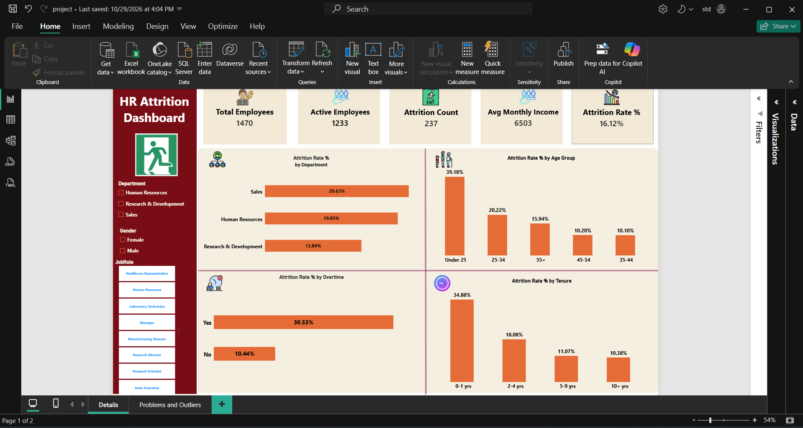
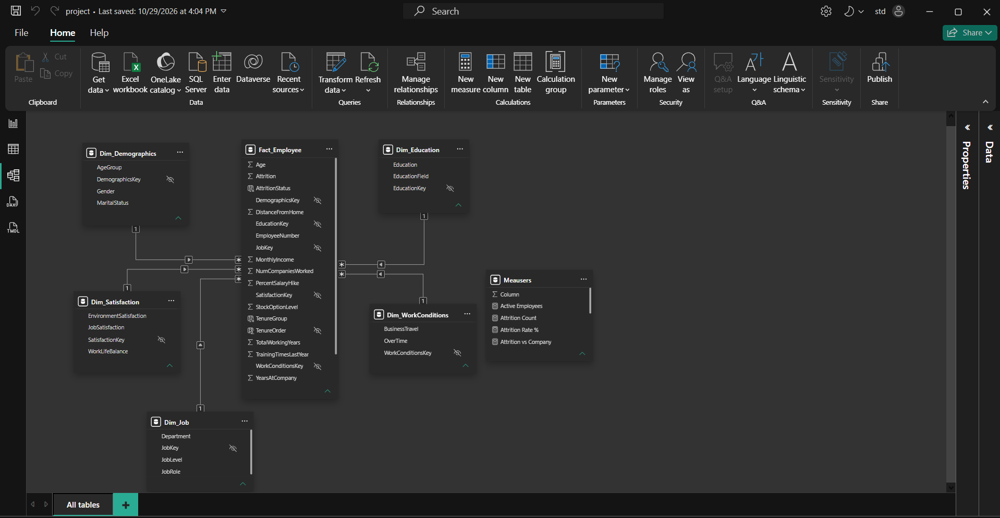
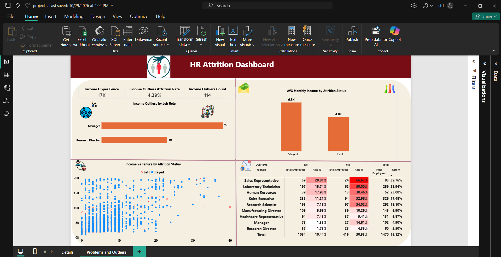
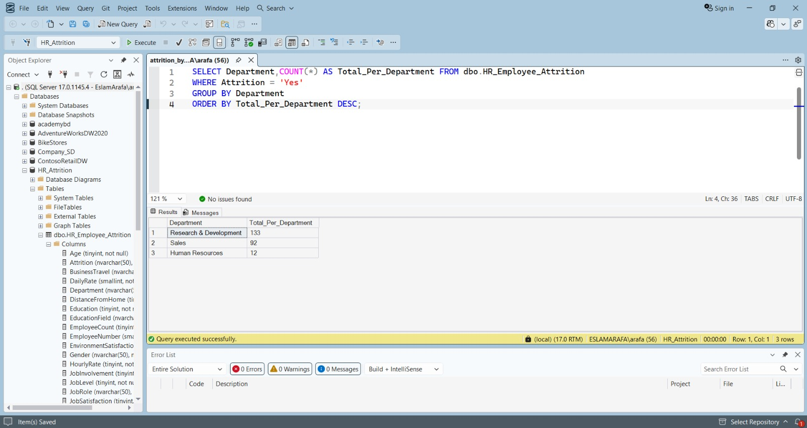

# HR Employee Attrition Analysis (Power BI + SQL)

This is a case study I worked on as a data analyst. The question was simple: **why are employees leaving, and where should HR look first?**

I was given one HR table with 1,470 employees and 35 columns. 237 of them had left, which is an attrition rate of **16.12%**. My job was to model the data, build a dashboard, find the patterns, and write recommendations.



## What I did

**1. Checked and cleaned the data**
- No empty or error values, and `EmployeeNumber` is unique.
- Removed three columns that have the same value for every employee: `EmployeeCount`, `Over18`, `StandardHours`.
- Changed `Attrition` from Yes/No to 1/0 (1 = left) so I could count and average it.
- Added an `AgeGroup` column (under 25, 25-34, 35-44, 45-54, 55+) and a tenure group (0-1, 2-4, 5-9, 10+ years).

**2. Built a star schema in Power Query**
I split the flat table into one fact table and five dimension tables, so the model is cleaner and easier to filter.



- `Fact_Employee`: the numbers (age, income, tenure, distance) and the Attrition flag
- `Dim_Job`: department, job role, job level
- `Dim_Demographics`: age group, gender, marital status
- `Dim_Education`: education level and field
- `Dim_WorkConditions`: business travel, overtime
- `Dim_Satisfaction`: environment satisfaction, job satisfaction, work-life balance

Each dimension connects to the fact table with a one-to-many relationship. I kept all my DAX measures in a separate `Measures` table: Active Employees, Attrition Count, Attrition Rate %, Attrition vs Company, and the income outlier measures.

**3. Built a 2-page Power BI dashboard**
- **Page 1 (Details):** KPI cards and attrition rate by department, age group, overtime and tenure, with slicers for department, gender and job role.
- **Page 2 (Problems and Outliers):** income outliers, average income of people who left vs stayed, income vs tenure, and a table of job role by overtime.



**4. Checked one question in SQL Server**
I wrote a query on the raw data to count exits by department. The result matches the dashboard (133 + 92 + 12 = 237).

```sql
SELECT Department, COUNT(*) AS Total_Per_Department
FROM dbo.HR_Employee_Attrition
WHERE Attrition = 'Yes'
GROUP BY Department
ORDER BY Total_Per_Department DESC;
```



## What I found

- **Department:** R&D has the most exits (133), but Sales has the highest rate (20.63%), then HR (19.05%) and R&D (13.84%).
- **Age:** employees under 25 leave at 39.18%, compared to about 10% for ages 35 to 54.
- **Tenure:** 34.88% of people leave in their first year. The rate drops to about 10% after 5 years.
- **Overtime:** 30.53% attrition with overtime vs 10.44% without. Overtime workers are about 28% of employees but about 54% of exits (127 of 237).
- **Job role with overtime:** Sales Representatives are the highest at 66.67%, but that is only 24 people. Laboratory Technicians are at 50.00% (62 people).
- **Income:** people who left earned about 4.8K a month on average, vs about 6.8K for those who stayed.
- **Outliers:** I used the IQR rule and found 114 employees above about 16.58K. All of them are Managers (74) or Research Directors (40), and their attrition is only 4.39%. These are real senior roles, so I kept them.

## Recommendations

1. Look at overtime workload first, starting with Sales Representatives, Laboratory Technicians and Research Scientists.
2. Give more support in the first two years, especially to employees under 25 (onboarding, check-ins).
3. Run exit interviews in Sales, HR and R&D to find out the real reasons.
4. Compare pay within the same role and level before changing anything.

I would test each action on a small group first and measure the result before expanding it.

## Limitations

- The data has no dates and no exit reasons, so the rates are a snapshot and not a yearly loss. I did not create a fake date column.
- These are relationships in the data, not proven causes. For example, income, job level and tenure move together.
- The units for income and distance are not stated, and the rating columns (education, satisfaction) have no labels. I followed the public dataset documentation for their meaning.
- Some groups are small, so rates like 66.67% should be read together with the number of employees.

## Files

- `data/`: the dataset (CSV)
- `powerbi/`: the Power BI file
- `sql/`: the SQL query
- `docs/`: the written recommendations and the presentation
- `images/`: screenshots used in this README

To open the Power BI file, change the data source path in Power Query (Transform data > Data source settings) to your own copy of the data.

## Tools

Power BI, Power Query, DAX, SQL Server (SSMS)

**Eslam Arafa** | [LinkedIn](https://linkedin.com/in/eslam-m-arafa/) | [GitHub](https://github.com/EslamArafa2003)

